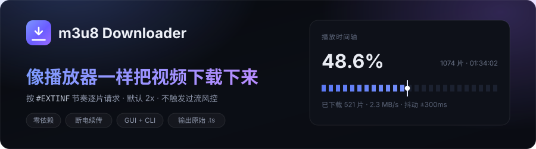
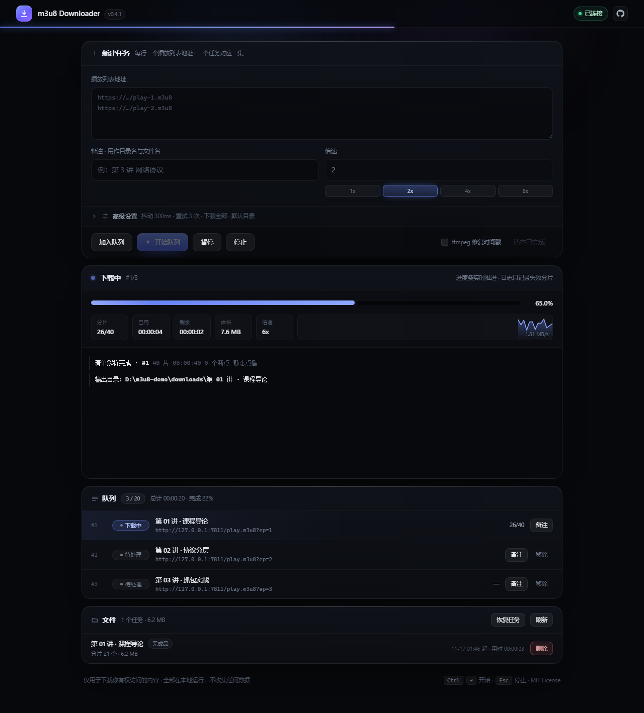
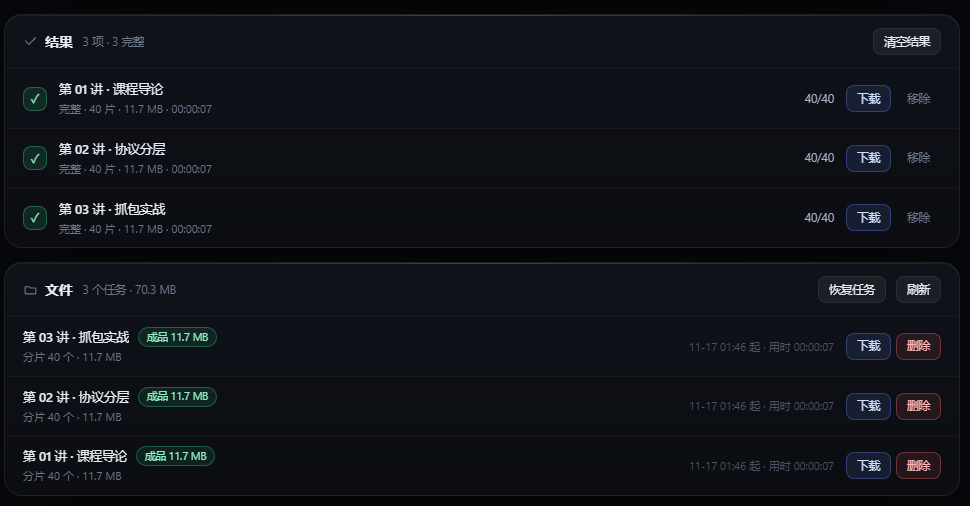
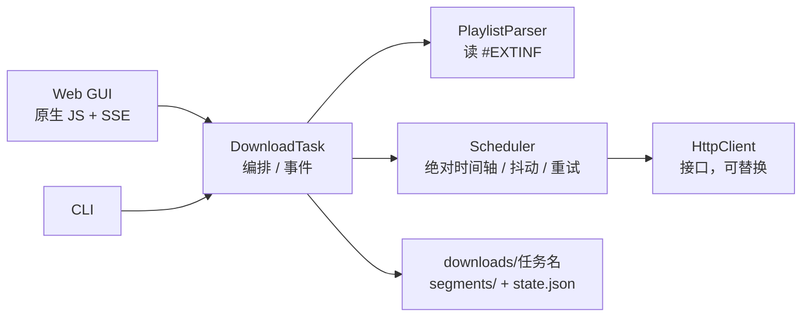

<div align="center">



**像播放器一样把 m3u8 下载下来** —— 按 `#EXTINF` 的节奏逐片请求，视频多长就下多久（默认 2 倍速），不触发服务端的过流风控。


[为什么需要它](#为什么需要它) · [特性](#特性) · [界面](#界面) · [快速开始](#快速开始) · [工作原理](#工作原理) · [HTTP 接口](#http-接口) · [常见问题](#常见问题)

</div>

---

> [!WARNING]
> **本项目仅供个人学习与备份使用。** 请只下载你有权访问的内容（自己买的课、自己的作品、版权方允许离线保存的内容），遵守目标平台的服务条款与当地法律。
>
> 它不提供、也不协助任何 DRM（Widevine / FairPlay / PlayReady）的破解，不绕过付费墙与会员权限；播放列表里出现 `#EXT-X-KEY` 会**直接报错退出**——这是设计上的拒绝，不是功能缺失。完整条款见[免责声明](#免责声明)。

## 为什么需要它

想把买过的课程回放存到本地，常见的两条路都有硬伤：

| 做法 | 服务端看到什么 | 代价 |
| :--- | :--- | :--- |
| 多线程下载器（16 并发） | 几秒内几百个分片请求，标准的爬虫特征 | 403、限速、临时封 IP |
| 录屏 | 和真人观看一致 | 二次编码画质有损、必须实时等、离开电脑就断 |
| **本项目** | 和一个正常播放器几乎一致：第 i 片只在「播放器本来会请求它」的那一刻发出 | 原始 TS 字节，画质无损 |

核心就一句话：**把整条播放列表换算成一条时间轴，然后模拟一个正在播放的播放器——它这一刻会请求哪一片，就请求哪一片，早一片都不请求。**

于是下载一个 1 小时 34 分的视频，服务端看到的请求分布，和真的有人用 2 倍速看了 47 分钟没有区别。

## 特性

| 能力 | 说明 |
| :--- | :--- |
| **节拍调度** | 绝对时间轴，不是逐片 `sleep`，误差不累积；总耗时 ≈ 视频时长 ÷ 倍速，与网速无关 |
| **不追赶** | 某片慢了就慢了，绝不为了补进度连发请求——补偿性突发比慢一点更像爬虫 |
| **随机抖动** | 每个请求时刻再加 ±300ms 独立随机偏移（默认开启，可调），避免整齐到可疑的间隔 |
| **断点续传** | 分片按序号独立落盘，重跑自动跳过已完成的 |
| **按需下载** | 只下指定区间（比如第 200–300 片）：先探测总片数再填区间，一次只加一个链接；文件名保留原序号，续传也只补这一段 |
| **断电可恢复** | 队列存档 + 磁盘自愈，断电 / `kill -9` 后重启自动找回任务，点「继续」只补缺失分片 |
| **失败隔离** | 单片重试 3 次（指数退避），失败不阻塞后续分片，最后精确列出缺哪几片 |
| **零依赖** | 只用 Node 内置能力，没有 `node_modules`，不需要 `npm install` |
| **无编译** | Node ≥ 22.6 直接执行 TypeScript（原生类型擦除） |
| **队列 + 改名** | 一次排多个地址串行执行；每个任务可起名，目录名与下载文件名都跟着变 |
| **文件管理** | 定时扫描磁盘，列出分片 / 成品占用、开始时间、耗时，可一键清理 |
| **浏览器交付** | 下完直接在页面上点「下载」，不用翻目录找文件 |
| **HTTP 层可替换** | 调度器只依赖 `HttpClient` 接口，换成 TLS 指纹实现时调度逻辑一行都不用改 |

## 界面

**下载中** —— 顶栏常驻进度线，控制台有分片数 / 已用 / 剩余 / 体积 / 倍速五块指标，右侧是最近一分钟的真实速率曲线；日志只记失败分片，不刷屏。



**结果与文件** —— 每个任务的成败、体积、耗时一目了然；成品直接下载，分片可单独清理腾空间。



## 工作原理



调度器每一片的全部逻辑：

```text
t0 = 开始时刻
for i in 0..n-1:
    deadline_i = t0 + (Σ_{j<i} EXTINF[j]) / speed   # 播放器本该请求它的时刻
    actual_i   = deadline_i + jitter                 # jitter ∈ [-300ms, +300ms]，独立采样
    sleep_until(actual_i)                            # 已经过点就立刻发，不追赶
    fetch(segment_i)
```

三个看起来不起眼、但决定了「像不像播放器」的决策：

1. **从请求发出时计时**，不是从下载完成。否则总耗时 = 视频时长 + Σ 下载耗时，会系统性偏慢，还会越拖越像批量任务。
2. **绝对时间轴**，不是逐片累加睡眠。否则每片的误差会累加，一小时后节奏完全走样。
3. **慢片不追赶**。一次性补发 20 个请求，比慢 20 秒更容易触发风控。

## 快速开始

| 依赖 | 必需 | 说明 |
| :--- | :---: | :--- |
| **Node.js ≥ 22.6** | ✅ | 需要原生 TypeScript 类型擦除，推荐 24+ |
| npm 包 | ❌ | 零依赖，不用装 |
| ffmpeg | ⭕ | 仅「修复时间戳」需要 |
| 浏览器 | ✅ | 只有 GUI 需要，任意现代浏览器 |

没装 Node：

```powershell
winget install OpenJS.NodeJS.LTS
```

### 方式一：GUI（推荐）

**双击 `start.cmd`** —— 脚本会自动找 Node、打印访问地址、2 秒后打开浏览器；关掉那个窗口就是停止服务。

```bash
node src/server.ts     # 也可以手动启，默认 http://127.0.0.1:7788
```

| 环境变量 | 作用 | 默认 |
| :--- | :--- | :--- |
| `PORT` | 监听端口 | `7788` |
| `HOST` | 监听地址，局域网访问填 `0.0.0.0` | `127.0.0.1` |
| `STATE_DIR` | 队列存档目录 | `<项目>/state` |
| `NO_BROWSER=1` | 不自动打开浏览器 | — |

### 方式二：命令行

```bash
node src/cli.ts "https://example.com/play.m3u8" --speed 2
node src/cli.ts "https://example.com/play.m3u8" --dry-run     # 只看清单结构
node src/cli.ts "https://example.com/play.m3u8" --limit 5 --speed 20 --out ./tmp
```

<details>
<summary><b>部署到 Linux 服务器（systemd 常驻，含开机自启）</b></summary>

**1. 装 Node**

```bash
VER=24.21.0
cd /tmp
wget -q https://nodejs.org/dist/v$VER/node-v$VER-linux-x64.tar.gz
wget -q https://nodejs.org/dist/v$VER/SHASUMS256.txt
sha256sum -c SHASUMS256.txt --ignore-missing
sudo mkdir -p /opt/node
sudo tar -xzf node-v$VER-linux-x64.tar.gz -C /opt/node --strip-components=1
sudo ln -sf /opt/node/bin/node /usr/local/bin/node
```

**2. 放代码**

```bash
sudo mkdir -p /opt/m3u8-downloader
sudo tar -xzf m3u8dl.tar.gz -C /opt/m3u8-downloader
sudo chown -R debian:debian /opt/m3u8-downloader
```

**3. 装服务**

```bash
sudo cp deploy/m3u8-downloader.service /etc/systemd/system/
sudo systemctl daemon-reload
sudo systemctl enable --now m3u8-downloader
systemctl status m3u8-downloader
```

**4. 访问**

局域网内打开 `http://<服务器IP>:7788`。

> [!NOTE]
> 服务默认只绑 `127.0.0.1`；单元文件里通过 `HOST=0.0.0.0` 对外开放，**没有任何登录认证**。只建议在可信网络里这么用，否则改走 SSH 隧道：
>
> ```bash
> ssh -L 7788:127.0.0.1:7788 user@server
> ```

</details>

## GUI 使用

1. 粘贴一个或多个 m3u8 地址（**每行一个**）
2. 设定倍速，可选填备注；抖动、重试次数、按需下载、输出目录都收在「**高级设置**」里，点一下展开（收起时标题行会显示当前取值）
3. 「加入队列」先排着，或「开始队列」立即开跑
4. 队列串行执行，控制台实时显示进度；失败分片单独成行
5. 结束后在「结果」看成败、在「文件」里下载成品或清理分片

**按需下载**：勾选后一次只能加一个链接。点「加入队列」时先读取播放列表、拿到总片数，再弹框填区间（例如 `200 ~ 300`），只下这一段；分片文件名保留原序号（`0200.ts`…），断电续传也只补这一段里缺的。同一链接的多个区间可以并存，目录名自动带区间后缀。

**队列与结果面板**：每个任务显示状态胶囊（待处理 / 下载中 / 完成 / 已中断 / 缺片）、体积、耗时；失败或中断的任务可以一键「补齐缺失」，只补缺的那几片。

**备注即文件名**：填了备注，输出目录和下载文件名都用它（备注「第一讲 网络基础」→ `downloads/第一讲 网络基础/output.ts`，浏览器下载得到 `第一讲 网络基础.ts`）。运行中改名只改显示名，任务结束后再重命名目录。

**快捷键**：`Ctrl+Enter` 开始队列，`Esc` 停止（有弹窗时先关弹窗）。参数与地址存在浏览器 `localStorage`，下次打开自动回填。

<details>
<summary><b>命令行参数全表</b></summary>

| 选项 | 说明 | 默认 |
| :--- | :--- | :--- |
| `--out <dir>` | 输出目录 | `downloads/<任务名>` |
| `--speed <n>` | 倍速；`0` 关闭节拍全速下载 | `2` |
| `--jitter <ms>` | 计划时刻的随机抖动 | `300` |
| `--retries <n>` | 单分片重试次数 | `3` |
| `--resume <mode>` | `fast` 跳过已下载 / `pace` 保持节奏 | `fast` |
| `--limit <n>` | 只下载前 n 片（调试用） | 全部 |
| `--range <a-b>` | 按需下载：只下第 a 到 b 片（含首尾），如 `--range 200-300` | 整条 |
| `--no-merge` | 下载完不拼接 | 拼接 |
| `--remux` | 拼接后用 ffmpeg 重建时间戳 | 关闭 |
| `--dry-run` | 只解析并打印统计，不下载 | — |
| `--quiet` | 不打印进度行 | — |

退出码：`0` 成功、`1` 出错、`2` 有分片失败、`130` 用户取消。

</details>

## 输出结构

```text
downloads/<任务名>/
├── playlist.m3u8        # 原始列表快照（事后可核对）
├── state.json           # 任务状态：URL、倍速、进度、失败分片
├── segments/0001.ts …   # 分片，文件名就是序号
└── output.ts            # 拼接产物
```

拼接是按序号的二进制顺序写入，**不经过任何转码**——成品字节数严格等于分片之和。

## 断电与崩溃恢复

服务器掉电、进程被 `kill -9`、容器被硬杀，都不会给程序收尾的机会。这里靠三层机制保证「文件还在，就一定能接着下」：

| 层 | 做法 | 解决什么 |
| :--- | :--- | :--- |
| **原子写** | 分片先写 `0007.ts.part`，写完再 `rename` 成 `0007.ts`；`output.ts`、`state.json`、队列存档同理 | 断电不会留下「名字像下完了、内容只有一半」的假分片被误认为已完成 |
| **磁盘即账本** | `state.json` 一开跑就写，之后每 5 秒更新，含 `url` / `status` / `note` / `speed` / 进度 | 重启后知道磁盘上这个目录属于哪个链接、下到哪了 |
| **双保险** | 队列写入 `state/queue.json`；读不到就扫 `downloads/*/`，用 `playlist.m3u8` 反推「应有多少片、已有多少片、缺哪几片」 | 连存档都丢了，也能把任务认领回来 |

| 场景 | 结果 |
| :--- | :--- |
| 断电后重启 | 队列自动恢复，任务显示「已中断」，点「继续」只补缺失分片 |
| `state/queue.json` 也丢了 | 扫盘认领，进度显示依然正确 |
| 成品已完整 | 直接显示「完成」，可下载，不会再下一遍 |
| 重新导入同一个链接 | 命中已有目录就复用续传，**不会**另建 `名字-2` 重下 |
| 老版本目录（没记 URL） | 认领后提示「绑定链接」，粘上地址即可续传 |

`cancelled` 是你主动点停止，`interrupted` 是没来得及停——两者都能继续。

想自己验证，跑自带的端到端脚本（会真的 `kill -9` 服务再重启）：

```bash
npm run test:crash     # 29 项断言，含「存档丢失靠磁盘认领」「老目录绑定链接续传」
```

## HTTP 接口

服务默认只监听 `127.0.0.1`，所有能力都通过下面这组接口暴露（GUI 自己调的就是它们），可以拿来接你自己的脚本或面板：

<details>
<summary><b>接口全表（点击展开）</b></summary>

| 方法 | 路径 | 说明 |
| :--- | :--- | :--- |
| `GET` | `/api/events` | SSE 事件流（进度 / 日志 / 队列） |
| `GET` | `/api/state` | 当前状态与可用产物 |
| `GET` `POST` | `/api/queue` | 队列快照 / `{urls, ...}` 入队（自动去重、超上限拒绝） |
| `DELETE` | `/api/queue?id=` | 移除待处理项（运行中的不可删） |
| `POST` | `/api/queue/start` · `/stop` · `/clear` | 开始 / 停止 / 清除已完成记录 |
| `POST` | `/api/queue/note` | `{id, note}` 改名（备注名即目录名与文件名） |
| `POST` | `/api/queue/retry` · `/retry-all` | 重新排队（只补缺失分片） |
| `POST` | `/api/queue/recover` | 重新扫描磁盘，认领断电前的任务目录 |
| `POST` | `/api/queue/attach` | `{id, url}` 给老任务补原始链接 |
| `GET` `DELETE` | `/api/files` | 扫描任务目录 / 删除该任务全部文件 |
| `GET` | `/api/download` | 下载成品，支持 `?task=` `?job=` `?path=` |
| `POST` | `/api/control` | `{action: pause \| resume \| cancel}` |
| `POST` | `/api/cleanup` | 删除分片目录，保留成品 |

</details>

## 边界与限制

明确**不做**的事，遇到时直接报错，不静默降级：

| 不支持 | 行为 |
| :--- | :--- |
| 主播放列表（master / 多码率） | 列出变体地址让你选，不自动挑 |
| 加密分片 `#EXT-X-KEY` | 直接报错退出 |
| fMP4 分片 `#EXT-X-MAP` | 直接报错退出 |
| 直播流 | 只处理带 `#EXT-X-ENDLIST` 的静态点播 |
| DRM（Widevine / FairPlay / PlayReady） | 完全不涉及 |

静默降级往往三小时后才暴露成「文件损坏」，所以这里选择立刻失败。

## 常见问题

<details>
<summary><b>双击 start.cmd 提示找不到 Node.js</b></summary>

装一个：`winget install OpenJS.NodeJS.LTS`。脚本会按 `PATH` → `%ProgramFiles%\nodejs` → `%LOCALAPPDATA%\Programs\nodejs` → scoop 的顺序查找。

</details>

<details>
<summary><b>端口 7788 被占用</b></summary>

设环境变量 `PORT=7799` 再启动。

</details>

<details>
<summary><b>下载的文件删不掉，提示「正由另一进程使用」</b></summary>

服务进程还在读它（通常是浏览器下载没结束）。等下载完，或关掉服务窗口，句柄就会释放。

</details>

<details>
<summary><b>播放时音画不同步 / 断点处花屏</b></summary>

列表里有 `#EXT-X-DISCONTINUITY`（时间戳跳变）时会这样。装好 ffmpeg 后勾选「用 ffmpeg 修复时间戳」，或 CLI 加 `--remux`，会产出 `output.fixed.ts`。分片都在，不用重新下载。

</details>

<details>
<summary><b>任务中断了，能接着下吗</b></summary>

能，而且不用管它是怎么断的。断电、崩溃、`kill -9` 之后重启服务，队列会自动恢复，任务显示「已中断」，点「继续」只补缺失分片。就算 `state/queue.json` 也丢了，也会扫 `downloads/` 认领回来。详见[断电与崩溃恢复](#断电与崩溃恢复)。

</details>

<details>
<summary><b>只想下其中一段（比如第 200–300 片）</b></summary>

在「高级设置」里勾选「按需下载」，只粘一个地址，点「加入队列」——会先读出这条播放列表的总片数，再让你填区间（比如 200 ~ 300）。CLI 等价写法是 `--range 200-300`。分片文件名仍是原序号，断电续传也只补这一段里缺的。

</details>

<details>
<summary><b>会不会因为请求太快被风控</b></summary>

节奏是按 `#EXTINF` 算出来的：1 倍速时就是播放器播放的节奏，2 倍速就是 2 倍速播放的节奏。再加上 ±300ms 随机抖动、慢片不追赶，服务端看到的请求分布与真实播放基本一致。

要更快可以调高倍速（`--speed 8`），但**倍速越高请求越密集**，风控风险由你自己权衡；`--speed 0` 是完全关闭节拍的全速模式，只建议下自己的静态资源。

</details>

<details>
<summary><b>磁盘占用太大</b></summary>

一个 3 小时的视频约 0.6 GB 分片 + 0.6 GB 成品。确认成品能播之后，在文件面板点「清理」删掉 `segments/`，成品保留但无法再续传。

</details>

## 项目结构

```text
src/
├── types.ts           # 类型与事件定义
├── control.ts         # 暂停 / 取消 / 时间轴平移
├── playlist.ts        # m3u8 解析
├── headers.ts         # 请求头 Profile
├── http.ts            # FetchHttpClient（HttpClient 接口的唯一实现）
├── scheduler.ts       # 绝对时间轴节拍 + 抖动 + 重试（核心）
├── store.ts           # 分片原子落盘 + state.json
├── disk.ts            # 扫盘认领（断电恢复的数据源）
├── merge.ts           # 二进制拼接（先 .part 再 rename）
├── files.ts           # 文件面板的数据源
├── task.ts            # DownloadTask 编排 + 事件发射
├── cli.ts             # 命令行入口
└── server.ts          # GUI 后端（HTTP + SSE）
web/                   # 原生 JS / CSS / HTML 前端
tests/                 # 断电续传端到端验证（真的 kill -9）
deploy/                # systemd 单元
```

约 2700 行 TypeScript + 3100 行原生前端，**零运行时依赖**。

## 开发

源码不需要编译，Node 直接执行。编辑器里想要完整类型提示：

```bash
pnpm add -D typescript @types/node
pnpm exec tsc --noEmit
```

调试时用高倍速或 `--limit` 缩小规模，别每次等几分钟：

```bash
node src/cli.ts "<url>" --limit 5 --speed 20 --out ./tmp
```

## 免责声明

<details>
<summary><b>完整条款（点击展开）</b></summary>

**一、用途限定** —— 仅用于下载你有权访问的内容：你本人已购买 / 已订阅 / 已获授权的内容、你拥有著作权的内容、版权方明确允许离线保存的内容。

**二、责任归属** —— 下载行为是否符合目标平台的服务条款由使用者自行判断；因使用本项目产生的任何法律纠纷、账号封禁、服务中断、数据丢失或其他损失，作者不承担责任。请自行确认并遵守所在国家或地区的著作权法。

**三、明确不提供的能力** —— 不含任何 DRM（Widevine / FairPlay / PlayReady）破解或绕过，不绕过付费墙、会员权限、试看限制，不获取或传播加密密钥，不对目标站点做扫描、攻击或压力测试。

**四、禁止行为** —— 请勿批量抓取并公开传播他人作品，请勿商业性复制、转售或再分发，请勿规避平台的技术保护措施。

**五、无担保** —— 按「现状」（AS IS）提供，不附带任何明示或暗示的担保，包括但不限于适销性、特定用途适用性与非侵权保证。

**六、数据与隐私** —— 不收集、不上传、不分析任何用户数据；所有请求由你的机器直接发往目标站点。GUI 默认只监听 `127.0.0.1`，参数只存在你浏览器本地的 `localStorage` 里。

**七、权利主张** —— 如果你是权利人，认为本项目侵犯了你的合法权益，请通过 Issue 联系，核实后会移除相关内容。

</details>

## 许可

[MIT](LICENSE)

---

<div align="center">

如果这个项目帮你把买过的课存回了本地，点个 Star ⭐ 是最好的鼓励。

</div>
